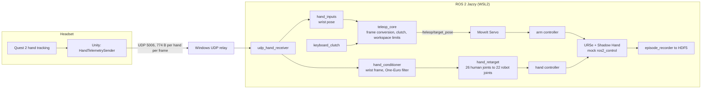

# Vr-robot-teleop

Real-time VR teleoperation of simulated UR5e arms with Shadow Hands using **Meta Quest 2 optical hand tracking**,
with a demonstration recorder for imitation learning. Your wrists drive the arms, your fingers drive the robot
fingers, and every run can be saved as a dataset.

> Add a screen recording here: `docs/media/demo.gif`.

**Status:** works end to end in simulation with a real Quest 2 (one arm, and an experimental two-arm setup).
Not done yet: physics-based grasping and a learned policy (see [Roadmap](#roadmap)). The simulation uses mock
`ros2_control` hardware, so there is no contact physics and no objects yet.

## How it works



1. **Quest app** (`quest_app/`): reads the 26 OpenXR hand joints of each hand through Unity's XR Hands package and
   streams them as small binary UDP packets ([protocol](docs/hand_protocol.md)).
2. **Bridge** (`quest_hand`): receives the packets, publishes a `HandSkeleton` message per hand, derives the wrist
   pose, and conditions the skeleton into the wrist frame with per-joint One-Euro filtering and tracking-dropout
   handling.
3. **Teleoperation core** (`quest_teleop_core`): converts OpenXR (Y-up) to ROS (Z-up), scales and clamps the motion,
   and implements a **relative clutch**: the robot target moves by the change in your hand pose since you engaged,
   so you can release, reposition your arm and engage again without the robot jumping. A watchdog stops the arm if
   hand data stops.
4. **Control** (`quest_teleop_control`): MoveIt Servo tracks the arm target (IK, speed limiting, singularity and
   joint-limit handling); a geometric **retargeter** maps the human fingers onto the 22 Shadow Hand joints.
5. **Description** (`quest_teleop_description`): UR5e + Shadow Hand xacro with mock hardware (wrist joints fixed).
6. **Data** (`quest_teleop_data`): records synchronised demonstrations to HDF5, replays them, and checks their
   health ([format](docs/dataset_format.md)).

## Repository layout

| Path | Contents |
|---|---|
| `quest_app/` | Unity scripts and setup guide for the headset ([README](quest_app/README.md)) |
| `ros2_ws/src/quest_bridge` | First-generation JSON pose receiver and fake sender (kept for bench tests) |
| `ros2_ws/src/quest_hand` | Binary receiver, skeleton conditioning, derived inputs, fake hand sender |
| `ros2_ws/src/quest_teleop_core` | Frame conversion, One-Euro filter, clutch, workspace limits |
| `ros2_ws/src/quest_teleop_control` | Controllers, MoveIt Servo, retargeting, bringup launch files |
| `ros2_ws/src/quest_teleop_description` | Robot description and meshes |
| `ros2_ws/src/quest_teleop_data` | Episode recorder, replay, dataset inspection |
| `ros2_ws/src/quest_teleop_msgs` | `HandSkeleton` message |
| `tools/` | Relay, keyboard clutch, description and protocol checkers, xacro generator |
| `docs/` | Protocol, dataset format, joint reference |

## What is verified

- **Unit tests** (plain pytest, no ROS needed): `quest_teleop_core` 18, `quest_hand` 22, `quest_teleop_control` 14,
  `quest_teleop_data` 7. They cover the maths that is easy to get wrong: frame conversion, filtering, the clutch,
  packet encoding and decoding, retargeting (including end-to-end through the conditioner), and the dataset format.
- **Cross-language check:** the C# packet encoder's bytes decode identically in the Python reference decoder
  (`python3 tools/verify_unity_packet.py`).
- **Description check:** `python3 tools/check_description.py` expands the xacro and asserts the structure.
- **Hardware in the loop:** the full chain has been run with a real Quest 2. The ROS nodes and launch files are not
  covered by automated tests.

## Requirements

- Windows 11 with **WSL2 (Ubuntu 24.04)**, ROS 2 **Jazzy**, MoveIt 2 (with Servo), `ur_description`,
  `ur_moveit_config`, `ros2_controllers`, `python3-h5py`.
- Meta Quest 2 on the same network, Unity 2022.3 LTS or Unity 6 with Android build support.

## Setup

### 1. ROS workspace (inside Ubuntu)

```bash
sudo apt install -y ros-jazzy-desktop ros-jazzy-moveit ros-jazzy-moveit-servo ros-jazzy-moveit-configs-utils \
  ros-jazzy-ur-description ros-jazzy-ur-moveit-config ros-jazzy-ros2-controllers \
  ros-jazzy-joint-state-publisher-gui ros-jazzy-xacro python3-h5py
git clone git@github.com:<you>/Vr-robot-teleop.git ~/Vr-robot-teleop
cd ~/Vr-robot-teleop/ros2_ws && colcon build && source install/setup.bash
```

Keep the repository in the Linux filesystem (`~/`), not under `/mnt/c`. Add the `source` line to `~/.bashrc`, and
re-source in any terminal opened before a build.

### 2. Network: Quest to WSL2

The headset can reach Windows but not the WSL2 virtual machine behind it (NAT mode). Run the relay on **Windows**:

```powershell
python tools\udp_relay_wsl.py
```

It listens on UDP 5006, discovers WSL's current address itself (it changes after `wsl --shutdown` or a reboot) and
forwards every packet. Allow UDP 5006 through the Windows firewall, and set the Unity app's **Host** to the Windows
PC's LAN IP (`ipconfig`). Check inside WSL with `ros2 topic hz /quest/right_hand/skeleton_raw` (about 60 to 72 Hz).

### 3. Quest app

Follow [`quest_app/README.md`](quest_app/README.md). Use the **OpenXR** provider in XR Plug-in Management (XR Hands
needs it), enable the Hand Tracking Subsystem feature, and test with the XR Hands *HandVisualizer* sample first.

## Running

### One arm

```bash
ros2 launch quest_teleop_control teleop_sim.launch.py real_headset:=true
python3 tools/keyboard_clutch.py        # SPACE toggles engage
```

Move your right wrist to move the arm; move your fingers to move the robot hand. With `launch_rviz:=true` (default)
RViz shows the robot, the target pose and your skeleton.

### Two arms (experimental, branch `two-arm`)

Arms sit at y = -0.3 (right, no prefix) and y = +0.3 (left, prefix `left_`); hands use prefixes `hand_` and
`left_hand_`. Each arm has its own Servo node (the left one in namespace `left`), controllers and `teleop_core`.

```bash
python tools\udp_relay_wsl.py                                              # Windows
ros2 launch quest_teleop_control teleop_sim.launch.py real_headset:=true   # right arm and hand
ros2 launch quest_teleop_control left_teleop.launch.py                     # left arm
ros2 launch quest_teleop_control left_hand.launch.py                       # left fingers (mirrored skeleton)
python3 tools/keyboard_clutch.py                                           # one global engage
```

| Topic | Type | Producer |
|---|---|---|
| `/quest/{left,right}_hand/skeleton_raw` | `HandSkeleton` | `udp_hand_receiver` |
| `/quest/{left,right}_hand/pose_raw` | `PoseStamped` | `hand_inputs` |
| `/quest/clutch` | `Float32` | `keyboard_clutch` (or the pinch gesture) |
| `/teleop/target_pose`, `/left/teleop/target_pose` | `PoseStamped` | `teleop_core` |
| `/teleop/engaged`, `/left/teleop/engaged` | `Bool` | `teleop_core` |
| `/teleop/{right,left}_hand/keypoints` | `HandSkeleton` | `hand_conditioner` |
| `/hand_position_controller/commands`, `/left_hand_position_controller/commands` | `Float64MultiArray` | `hand_retarget` |

### Recording and replaying demonstrations

```bash
ros2 launch quest_teleop_data record.launch.py output_dir:=$HOME/Vr-robot-teleop/datasets
ros2 service call /episode_recorder/start std_srvs/srv/Trigger
ros2 service call /episode_recorder/stop  std_srvs/srv/SetBool "{data: true}"     # true = success
ros2 run quest_teleop_data inspect_dataset datasets/session_<timestamp>.hdf5
ros2 run quest_teleop_data replay_episode --ros-args -p file:=<path> -p demo:=demo_0
```

`inspect_dataset` flags files that are structurally fine but contain no motion (clutch never engaged, hand never
tracked). Recordings are git-ignored.

### Testing without a headset

```bash
ros2 launch quest_teleop_control teleop_sim.launch.py real_headset:=true
ros2 run quest_hand fake_hand_sender --left-clutch
```

## Configuration and tuning

| What | Where | Notes |
|---|---|---|
| Motion scale, workspace box, facing direction (`base_yaw_deg`) | `quest_teleop_core/config/teleop.yaml` | `base_yaw_deg` rotates hand motion into the robot frame |
| Tracking dropouts | `teleop.yaml`: `input_timeout`, `require_release_after_timeout` | `false` = arms resume by themselves |
| Hand smoothing | `quest_hand/config/hand.yaml` (`filter.min_cutoff`, `filter.beta`) | higher = less lag, more jitter |
| Finger mapping gains and signs | `quest_teleop_control/config/retarget.yaml` | live: `ros2 param set /hand_retarget <name> <value>` |
| Finger speed cap | `max_joint_speed` | live parameter |

## Known limitations

- Simulation only: mock hardware, no contact physics, no objects. MoveIt Servo collision checking is **off**
  because the model lacks allowed-collision entries for the hand links.
- Finger retargeting is a geometric baseline; the thumb is a heuristic, and joint-direction signs for the Shadow
  model were inferred from joint limits.
- The two-arm setup is experimental, and the left robot hand is the right-hand model driven by a mirrored skeleton.
- The Windows relay is a workaround for WSL2 NAT mode (mirrored networking did not work on the author's machine).

## Troubleshooting

| Symptom | Cause and fix |
|---|---|
| `package not found` / `message type is invalid` | The terminal has not sourced the workspace. |
| Duplicate node name warnings | An old launch or fake sender is still running. Stop everything and relaunch. |
| Nothing arrives from the headset | Relay running? Host IP correct? Firewall rule for UDP 5006? `adb logcat -s Unity` shows the sender status. |
| Arms engage then stop | Tracking dropouts. Use `keyboard_clutch.py` and set `require_release_after_timeout: false`. |
| Arm moves in the wrong direction | Tune `base_yaw_deg`; check the XR Origin in Unity has no rotation. |
| Fingers idle | `hand_retarget` logs why (usually not engaged). `ros2 param set /hand_retarget require_engaged false` to bypass. |
| Blank RViz window on WSLg | `LIBGL_ALWAYS_SOFTWARE=1 QT_QPA_PLATFORM=xcb rviz2` |
| Unity finds no hand subsystem | Enable the OpenXR provider and the Hand Tracking Subsystem feature; verify with HandVisualizer. |

## Roadmap

- [x] Quest hand tracking to a simulated arm and hand, with clutch, filtering and retargeting
- [x] Demonstration recorder, HDF5 format, replay and health checks
- [ ] Collision matrix so Servo can check arm and hand collisions
- [ ] MuJoCo scene with objects and automatic success detection
- [ ] Bimanual task (handover) with demonstrations collected by teleoperation
- [ ] Behavior-cloning baseline, then action-chunking / diffusion policies; learning curves vs demonstration count
- [ ] Human-in-the-loop corrections (take over with VR when the policy fails)

## License

MIT.

## Acknowledgements

Shadow Hand model derived from [`shadow_hand_ign`](https://github.com/AndrejOrsula/shadow_hand_ign) and
[`sr_common`](https://github.com/shadow-robot/sr_common); arm description and Servo configuration from
[Universal Robots ROS 2](https://github.com/UniversalRobots). See `THIRD_PARTY_NOTICES.md`.
