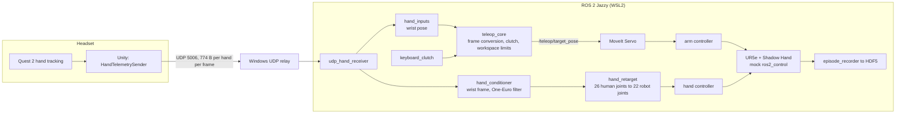

# Vr-robot-teleop

Real-time VR teleoperation of simulated UR5e arms with Shadow Hands using **Meta Quest 2 optical hand tracking**,
with a demonstration recorder for imitation learning. Your wrists drive the arms, your fingers drive the robot
fingers, and every run can be saved as a dataset.

**[Full VR teleoperation demonstration](docs/full_vr_teleop_demo.md)**

## Video Demonstration:


https://github.com/user-attachments/assets/907275ac-c69a-42af-a1bd-06c723dd5702


Control both arms and both hands: position, wrist twist/tilt, finger articulation, clutch and mock-arm reset.
The guide includes the complete startup sequence and a short demonstration walkthrough.

**Status:** full two-arm VR teleoperation demonstrated with a real Quest 2 and simulated UR5e + Shadow Hands.
The operator has confirmed position directions, wrist twist/tilt, hand posture and reset. The latest wrist speed
cap is 0.9 rad/s (~52 degrees/s), verified in the mock simulation; subjective responsiveness needs operator confirmation.
Not done yet: physics-based grasping and a learned policy (see [Roadmap](#roadmap)). The simulation uses mock
`ros2_control` hardware, so there is no contact physics and no objects yet.

## How it works



1. **Quest app** (`quest_app/`): reads the 26 OpenXR hand joints of each hand through Unity's XR Hands package and
   streams them as small binary UDP packets ([protocol](docs/hand_protocol.md)).
2. **Bridge** (`quest_hand`): receives the packets, publishes a `HandSkeleton` message per hand, derives the wrist
   pose, and conditions the skeleton into the wrist frame with per-joint One-Euro filtering and tracking-dropout
   handling.
3. **Teleoperation core** (`quest_teleop_core`): converts OpenXR (Y-up) to ROS (Z-up), scales and clamps the motion,
   and implements a **relative clutch**: the robot target moves by the change in your hand pose since you engaged,
   so you can release, reposition your arm and engage again without the robot jumping. A watchdog stops the arm if
   hand data stops.
4. **Control** (`quest_teleop_control`): MoveIt Servo tracks the arm target (IK, speed limiting, singularity and
   joint-limit handling); a geometric **retargeter** maps the human fingers onto the 22 Shadow Hand joints.
5. **Description** (`quest_teleop_description`): UR5e + Shadow Hand xacro with mock hardware (wrist joints fixed).
6. **Data** (`quest_teleop_data`): records synchronised demonstrations to HDF5, replays them, and checks their
   health ([format](docs/dataset_format.md)).

## Repository layout

| Path | Contents |
|---|---|
| `quest_app/` | Unity scripts and setup guide for the headset ([README](quest_app/README.md)) |
| `ros2_ws/src/quest_bridge` | First-generation JSON pose receiver and fake sender (kept for bench tests) |
| `ros2_ws/src/quest_hand` | Binary receiver, skeleton conditioning, derived inputs, fake hand sender |
| `ros2_ws/src/quest_teleop_core` | Frame conversion, One-Euro filter, clutch, workspace limits |
| `ros2_ws/src/quest_teleop_control` | Controllers, MoveIt Servo, retargeting, bringup launch files |
| `ros2_ws/src/quest_teleop_description` | Robot description and meshes |
| `ros2_ws/src/quest_teleop_data` | Episode recorder, replay, dataset inspection |
| `ros2_ws/src/quest_teleop_msgs` | `HandSkeleton` message |
| `tools/` | Relay, keyboard clutch, description and protocol checkers, xacro generator |
| `docs/` | Protocol, dataset format, joint reference |

## What is verified

- **Unit tests:** frame conversion, filtering, mapping, protocol, conditioning, retargeting and dataset I/O.
- **Clutch regression tests:** both arms' configuration and real node callbacks, with captured publishers.
  They cover released-state gating for arm and fingers, tracking timeout/release/re-engagement, stale poses,
  missing TF and re-anchoring. These need ROS; they do not launch Servo or send controller commands.
- **Cross-language check:** `python3 tools/verify_unity_packet.py` checks rotation mathematics and the C# encoder.
  Requires .NET 8 for the encoder; exits 2 for an incomplete check, 1 for failure, 0 only when both pass.
- **Description check:** `python3 tools/check_description.py` checks both two-arm variants, with and without
  the left hand, including control coverage for every movable joint.
- **Live operator acceptance:** both arms and fingers respond to Quest hand tracking; forward/back, sideways,
  vertical movement, wrist twist/tilt, inward-facing thumbs and mock reset were confirmed during development.
- **Headless mock acceptance:** both arms follow position, twist and tilt targets; clutch release, tracking-loss
  recovery, reset/re-anchoring and paired recording pass `tools/smoke_teleop.py`.
- **Latest regression run:** 106 tests passed across core, control, hand processing and dataset packages.
  Both robot-description variants passed, and the full mock acceptance check passed with the 0.9 rad/s cap. These are simulation results, not physical
  robot or grasping validation.

From the repository root, with ROS and the workspace sourced:

```bash
export PYTHONPATH="$PWD/ros2_ws/src/quest_teleop_core:$PWD/ros2_ws/src/quest_hand:$PWD/ros2_ws/src/quest_teleop_control:$PWD/ros2_ws/src/quest_teleop_data:$PWD/ros2_ws/src/quest_bridge:$PYTHONPATH"
python3 -m pytest ros2_ws/src/*/test -q
python3 tools/check_description.py
python3 tools/verify_unity_packet.py
```

## Requirements

- Windows 11 with **WSL2 (Ubuntu 24.04)**, ROS 2 **Jazzy**, MoveIt 2 (with Servo), `ur_description`,
  `ur_moveit_config`, `ros2_controllers`, `python3-h5py`.
- Meta Quest 2 on the same network, Unity 2022.3 LTS or Unity 6 with Android build support.

## Setup

### 1. ROS workspace (inside Ubuntu)

```bash
sudo apt install -y ros-jazzy-desktop ros-jazzy-moveit ros-jazzy-moveit-servo ros-jazzy-moveit-configs-utils \
  ros-jazzy-ur-description ros-jazzy-ur-moveit-config ros-jazzy-ros2-controllers \
  ros-jazzy-joint-state-publisher-gui ros-jazzy-xacro python3-h5py
git clone git@github.com:<you>/Vr-robot-teleop.git ~/Vr-robot-teleop
cd ~/Vr-robot-teleop/ros2_ws && colcon build && source install/setup.bash
```

Keep the repository in the Linux filesystem (`~/`), not under `/mnt/c`. Add the `source` line to `~/.bashrc`, and
re-source in any terminal opened before a build.

### 2. Network: Quest to WSL2

The headset can reach Windows but not the WSL2 virtual machine behind it (NAT mode). Run the relay on **Windows**:

```powershell
python tools\udp_relay_wsl.py
```

It listens on UDP 5006, discovers WSL's current address itself (it changes after `wsl --shutdown` or a reboot) and
forwards every packet. Allow UDP 5006 through the Windows firewall, and set the Unity app's **Host** to the Windows
PC's LAN IP (`ipconfig`). Check inside WSL with `ros2 topic hz /quest/right_hand/skeleton_raw` (about 60 to 72 Hz).

### 3. Quest app

Follow [`quest_app/README.md`](quest_app/README.md). Use the **OpenXR** provider in XR Plug-in Management (XR Hands
needs it), enable the Hand Tracking Subsystem feature, and test with the XR Hands *HandVisualizer* sample first.

## Running

### Full two-arm VR teleoperation

Follow the [complete demonstration guide](docs/full_vr_teleop_demo.md) for separate Windows and Ubuntu commands.
You need the **Quest app**, **Windows UDP relay**, and **four Ubuntu terminals**. In every Ubuntu terminal:

```bash
cd ~/Vr-robot-teleop
source /opt/ros/jazzy/setup.bash
source ros2_ws/install/setup.bash
```

Run one command per terminal:

```bash
# Terminal 1: mock robot, RViz, both Servo nodes, right arm and right fingers
ros2 launch quest_teleop_control teleop_sim.launch.py real_headset:=true track_orientation:=true
```
```bash
# Terminal 2: left arm tracking
ros2 launch quest_teleop_control left_teleop.launch.py track_orientation:=true
```
```bash
# Terminal 3: left fingers
ros2 launch quest_teleop_control left_hand.launch.py
```
```bash
# Terminal 4: shared keyboard clutch, status display and mock reset
python3 tools/keyboard_clutch.py
```

Keep focus in terminal 4 for keyboard controls. Do not start duplicate copies.
The arms sit at y = -0.3 (right) and +0.3 (left). Each has its own Servo node and
teleoperation core. The left hand model mirrors the right model's geometry and
joint axes; retargeting still uses canonical hand coordinates.

| Key | Action |
|---|---|
| **Space** | Engage/release both arms and finger control |
| **0** | Release the clutch |
| **R** | Release, pause Servo and gradually return both mock arms to the ready pose; finish released |
| **Q** | Quit the keyboard controller and release |

Hold your hands comfortably, engage, then move and rotate your wrists and articulate your fingers.
Release before repositioning your hands; re-engagement anchors to the measured robot pose.
The ready posture has fingers forward, palms down and thumbs inward. The Shadow model's own wrist
joints are fixed: the UR5e arm joints provide wrist orientation.

| Topic | Type | Producer |
|---|---|---|
| `/quest/{left,right}_hand/skeleton_raw` | `HandSkeleton` | `udp_hand_receiver` |
| `/quest/{left,right}_hand/pose_raw` | `PoseStamped` | `hand_inputs` |
| `/quest/clutch` | `Float32` | `keyboard_clutch` only |
| `/teleop/target_pose`, `/left/teleop/target_pose` | `PoseStamped` | `teleop_core` |
| `/teleop/engaged`, `/left/teleop/engaged` | `Bool` | `teleop_core` |
| `/teleop/{right,left}_hand/keypoints` | `HandSkeleton` | `hand_conditioner` |
| `/hand_position_controller/commands`, `/left_hand_position_controller/commands` | `Float64MultiArray` | `hand_retarget` |

Run each long-running command in a separate terminal. `ros2 topic info /quest/clutch` should show exactly
one publisher. SPACE toggles engagement; 0 releases both arms. After a tracking timeout, release and engage
again once tracking returns. Pinch telemetry remains available on `/quest/clutch_gesture` but does not engage
the arms. To deliberately use pinch instead, route that topic to the cores and stop the keyboard publisher.

For both skeleton displays, open the installed `quest_teleop_control/rviz/teleop_two_arm.rviz` configuration
in RViz; the default launch still selects the right-hand display.

### Recording and replaying demonstrations

The recorder defaults to right-arm schema v1. Add `bimanual:=true` for both arms on one sample clock
(schema v2, 58 action columns ordered right then left). See [dataset format](docs/dataset_format.md).
Release the keyboard clutch before replay so live teleoperation does not compete with recorded commands.

```bash
ros2 launch quest_teleop_data record.launch.py output_dir:=$HOME/Vr-robot-teleop/datasets bimanual:=true
ros2 service call /episode_recorder/start std_srvs/srv/Trigger
ros2 service call /episode_recorder/stop  std_srvs/srv/SetBool "{data: true}"     # true = success
ros2 run quest_teleop_data inspect_dataset datasets/session_<timestamp>.hdf5
ros2 run quest_teleop_data replay_episode --ros-args -p file:=<path> -p demo:=demo_0 -p bimanual:=true
```

`inspect_dataset` flags files that are structurally fine but contain no motion (clutch never engaged, hand never
tracked), separately for each arm. Recordings are git-ignored. For existing single-arm files, omit
`-p bimanual:=true` when replaying.

### Testing without a headset

```bash
ros2 launch quest_teleop_control teleop_sim.launch.py real_headset:=true
ros2 run quest_hand fake_hand_sender --left-clutch
python3 tools/keyboard_clutch.py   # separate terminal; fake pinch does not engage the arms
```

### Headless simulation acceptance check

With ROS and the built workspace sourced:

```bash
python3 tools/smoke_teleop.py
```

This uses localhost ROS domain 174, verifies that all four hardware plugins are mock components, and launches
no RViz or UDP receiver. It checks both arms' 3 cm forward/right/up motions, release gating, dropout recovery
paired recording through the recorder services, mock-arm reset, no-jump re-engagement,
and 5 degrees wrist twist and tilt tracking. Only its own processes are stopped afterward.
Logs and the diagnostic HDF5 file remain under `ros2_ws/log/teleop_smoke_*`.
The test supplies wrist poses, not optical skeletons: both tracking warnings in that dataset are expected;
it is not a manipulation demonstration. End-to-end latency and grasping success have not been measured.

## Configuration and tuning

| What | Where | Notes |
|---|---|---|
| Motion scale, workspace box, facing direction (`base_yaw_deg`) | `quest_teleop_core/config/teleop.yaml` | Fixed alignment; no continuous headset-POV tracking |
| Accepted position directions | `teleop.yaml`: `invert_forward: true`, `invert_lateral: true` | Reverse base-frame X/Y displacement; preserve height |
| Accepted wrist directions | `teleop.yaml`: `mirror_orientation: true`, `invert_tilt: true` | Relative roll/yaw reflection plus pitch inversion; preserve clutch anchor |
| Wrist tracking | `teleop.yaml`: `track_orientation: true` | `false` freezes orientation for position-only diagnosis |
| Wrist speed cap | `quest_teleop_control/config/{servo,left_servo}.yaml`: `scale.rotational: 0.9` | ~52 degrees/s maximum; singularity and joint limits can slow or stop motion |
| Tracking dropouts | `teleop.yaml`: `input_timeout`, `require_release_after_timeout` | `false` = arms resume by themselves |
| Hand smoothing | `quest_hand/config/hand.yaml` (`filter.min_cutoff`, `filter.beta`) | higher = less lag, more jitter |
| Finger mapping gains and signs | `quest_teleop_control/config/retarget.yaml` | live: `ros2 param set /hand_retarget <name> <value>` |
| Finger speed cap | `max_joint_speed` | live parameter |

## Known limitations

- Simulation only: mock hardware, no contact physics, no objects. MoveIt Servo collision checking is **off**
  because the model lacks allowed-collision entries for the hand links.
- Finger retargeting is a geometric baseline; the thumb is a heuristic, and joint-direction signs for the Shadow
  model were inferred from joint limits.
- The left hand is a mirrored simulation model, not a validated physical left Shadow Hand configuration.
- Head pose is not transmitted. Alignment is fixed, and wrist rotation is relative to clutch engagement.
- Mock reset is not collision planned and refuses non-mock hardware. It needs both teleop cores and fresh
  joint feedback. If reset fails, restart the simulation; Servo may remain paused.
- The Windows relay is a workaround for WSL2 NAT mode (mirrored networking did not work on the author's machine).

## Troubleshooting

| Symptom | Cause and fix |
|---|---|
| `package not found` / `message type is invalid` | The terminal has not sourced the workspace. |
| Duplicate node name warnings | An old launch or fake sender is still running. Stop everything and relaunch. |
| Nothing arrives from the headset | Relay running? Host IP correct? Firewall rule for UDP 5006? `adb logcat -s Unity` shows the sender status. |
| Arms engage then stop | Check tracking gaps. Default recovery requires keyboard release, then re-engage with fresh tracking. |
| Arm moves in the wrong direction | Check the configured position inversions and fixed `base_yaw_deg`; test one axis at a time. |
| Wrist stays fixed | Confirm `track_orientation:=true`, engaged status, fresh tracking and Servo status. |
| Servo reports a singularity stop | Press **R** in the keyboard terminal for mock reset, then reposition your hands and press Space. |
| Wrist rotation slows | The 0.9 rad/s cap is a maximum; singularity and joint-limit protection can reduce it. |
| Fingers idle | `hand_retarget` logs why (usually not engaged). `ros2 param set /hand_retarget require_engaged false` to bypass. |
| Blank RViz window on WSLg | `LIBGL_ALWAYS_SOFTWARE=1 QT_QPA_PLATFORM=xcb rviz2` |
| Unity finds no hand subsystem | Enable the OpenXR provider and the Hand Tracking Subsystem feature; verify with HandVisualizer. |

## Roadmap

- [x] Quest hand tracking to a simulated arm and hand, with clutch, filtering and retargeting
- [x] Demonstration recorder, HDF5 format, replay and health checks
- [x] Full two-arm VR position, wrist and finger control, with live operator direction checks
- [x] Automated mock movement, wrist twist/tilt, dropout recovery and reset checks
- [ ] Measure end-to-end tracking/control latency and record a shareable demo video
- [x] Record paired observations/actions for both arms, with dataset quality checks and manual success labels
- [ ] Collision matrix so Servo can check arm and hand collisions
- [ ] MuJoCo scene with objects and automatic success detection
- [ ] Single-arm grasp-and-place demonstrations and baseline evaluation, then a bimanual task (handover proposed)
- [ ] Behavior-cloning baseline, then action-chunking / diffusion policies; learning curves vs demonstration count
- [ ] Human-in-the-loop corrections (take over with VR when the policy fails)

## License

MIT.

## Acknowledgements

Shadow Hand model derived from [`shadow_hand_ign`](https://github.com/AndrejOrsula/shadow_hand_ign) and
[`sr_common`](https://github.com/shadow-robot/sr_common); arm description and Servo configuration from
[Universal Robots ROS 2](https://github.com/UniversalRobots). See `THIRD_PARTY_NOTICES.md`.
